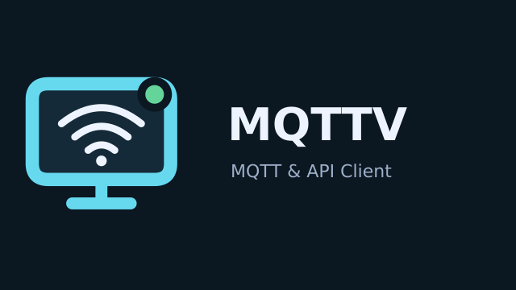
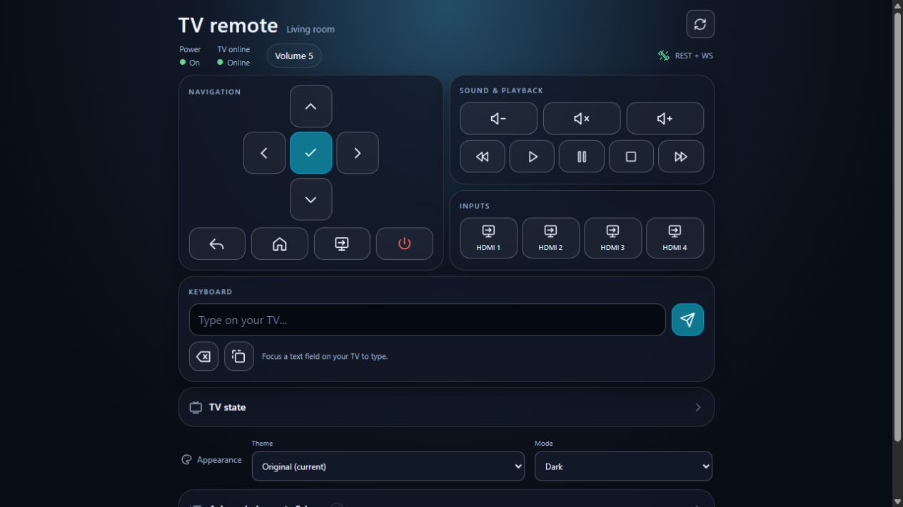
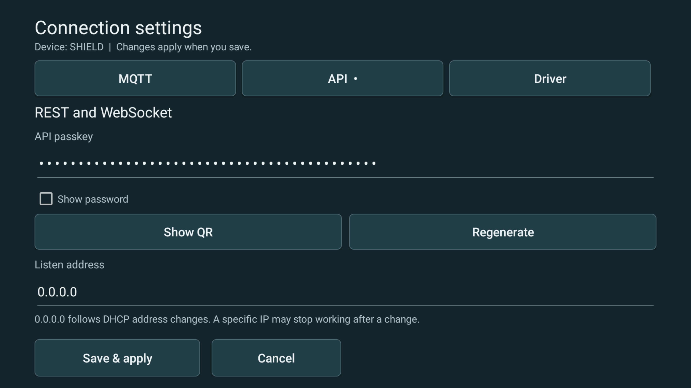
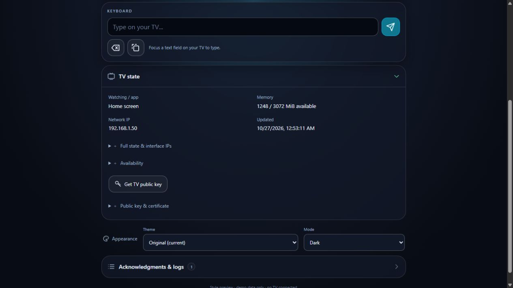

# MQTTV

**TV MQTT & API Client** adds a background MQTT client, REST/WebSocket API and phone remote to Android TVs. One APK supports Sony BRAVIA and NVIDIA Shield, selected in settings.



## Packages and drivers

| Package | Drivers | Status |
| --- | --- | --- |
| Android APK | Sony BRAVIA, NVIDIA Shield | Normal APK installation; debugging is optional |
| Samsung Tizen WGT | Samsung Tizen | Experimental; signing, sideloading and physical-TV validation remain necessary |

Both targets implement MQTT, REST and WebSocket control. The primary build outputs are one APK and one WGT. The custom-install Tizen service archive is an optional development artifact, built only with --service-bundle.

## Install and connect

1. Download the [0.1.0 APK](https://github.com/Slyke/MQTTV/releases/tag/v0.1.0), transfer it to the TV and install it with an Android TV APK installer.
2. Open **TV MQTT & API Client → Connection settings**. Choose the driver and enter your MQTT broker settings, or use the local API alone.
3. On Shield, enable **TV remote control** in Android Accessibility settings using the button in the Driver tab. For native playback controls, also enable **Allow playback control & media reporting** in **Advanced options**. On Sony, configure the TV's local IP-control API and matching pre-shared key.
4. Choose **Save & apply**, then **Start**. Scan **Open on phone** to open the remote already signed in.

Install Android updates over the existing APK to preserve configuration and keys. Official releases use the same signing identity; uninstalling first deletes app data.

Normal Android APK installation and settings changes do not require ADB or developer mode. An explicit developer fallback is available for apps whose controls are inaccessible through Android Accessibility. Open **Advanced options → Driver setup & permissions** for the selected Android driver, Accessibility and optional debugging instructions. Samsung Tizen has its own guide under Advanced options; its installation process is different from APK installation.

Leave the MQTT base topic blank to use `tvs/<device-name>/`. Each TV needs a unique MQTT client ID. The API listens on `0.0.0.0` by default, so DHCP address changes do not require reconfiguring the listener. Scan a fresh phone QR after the TV's IP changes.

## Phone remote

The simple remote is served directly by the TV. It includes navigation, playback, text editing, volume controls, live state, acknowledgments and saved light/dark themes.



<details>
<summary>TV settings and additional remote details</summary>





The browser screenshots use simulated device data.
</details>

HTTP/WS is enabled and HTTPS/WSS is off for a new installation. Enabling HTTPS creates a persistent self-signed identity on the TV; browsers may show a certificate warning. API passkeys are generated on the TV and can be shown as QR codes or regenerated. Open on phone uses the same passkey to establish a browser session; there is no separate permanent WUI key. The HTTPS private key stays in AndroidKeyStore.

## MQTT and API

For a base topic of `tvs/living-room`:

| Topic | Purpose |
| --- | --- |
| `tvs/living-room/cmnd/COMMAND` | Send a JSON command |
| `tvs/living-room/stat/RESULT` | Timestamped acknowledgment with command ID |
| `tvs/living-room/tele/STATE` | State snapshot, retained by default |
| `tvs/living-room/tele/LWT` | Retained availability and connection-time IP information |

```json
{"id":"phone-001","action":"left"}
```

Commands include power, navigation, volume, playback, text, counted Backspace, Select All and status. Supported commands depend on the driver and foreground app. Never retain command messages.

REST uses `X-API-Key` authentication: `GET /api/state` reads state and `POST /api/command` accepts the same command object. WebSocket `/api/ws` streams `{"state": {...}}` and `{"ack": {...}}`. MQTT and API commands share persistent ID deduplication.

Telemetry includes power, available app/media information, memory, network addresses per interface, storage and system statistics. Unavailable readings are marked accordingly. MQTT supports plaintext and TLS, including self-signed certificates and an optional certificate-verification bypass.

See the [Android guide](mqtt-client/README.md) for configuration, commands, API details and build instructions.

## Compatibility and limits

- **Sony BRAVIA:** Android 8+ with compatible local HTTP/IRCC APIs. Enable IP control and configure its pre-shared key. Custom app keyboards may require the optional developer text fallback.
- **NVIDIA Shield:** Accessibility is the default on-device control method. Some apps, including some YouTube interfaces, do not expose usable navigation/text nodes; developer ADB control is an explicit fallback.
- **Shield volume:** system mode requests volume through Android; support depends on the connected TV/receiver. A physical remote's IR support does not imply app control. External volume support is reported as unknown; the app keeps relative controls available and does not infer TV compatibility from the CEC setting. External volume has no readback. Optional device mode controls the Shield's PCM stream and does not control bitstreamed audio.
- **Standby:** firmware may suspend the service or network during prolonged standby. Wake and attached-display behavior depend on power management and HDMI-CEC.

## Source and development

- [Android client](mqtt-client/README.md): APK and TV-hosted simple remote.
- [PC browser relays](remote-wuis/README.md): optional Node API and MQTT development apps.
- [Style preview](mqtt-client/preview/README.md): simulated browser layout tool.
- [Samsung Tizen client](tizen-client/README.md): experimental source and unsigned packages; physical installation/control validation is pending.

With JDK 17, Android SDK 35, Python 3.10+ and Node 20+, run `python3 tools/build-all.py` to test and build Android and Tizen concurrently. GitHub Actions builds both targets independently. Official Android downloads use a maintained signing identity; CI debug artifacts use a development key and may require a separate installation.

## Local configuration

No device credentials or private keys are bundled. Local JSON profiles, keys, generated files and `local-files/` are ignored by Git. Keep private deployments and personal research there. Restrict API and MQTT access to your intended network and users; HTTP and disabling certificate validation reduce transport protection.

[MIT license](LICENSE) · [Android third-party notices](mqtt-client/THIRD_PARTY.md)
